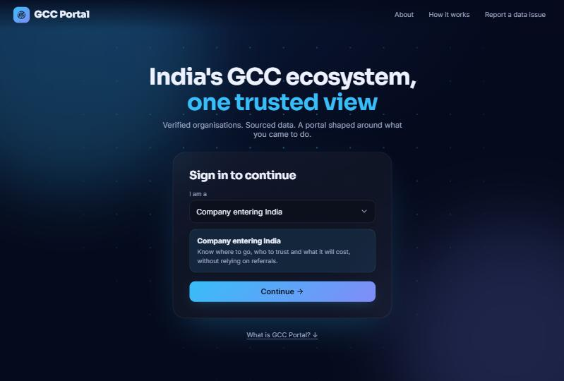
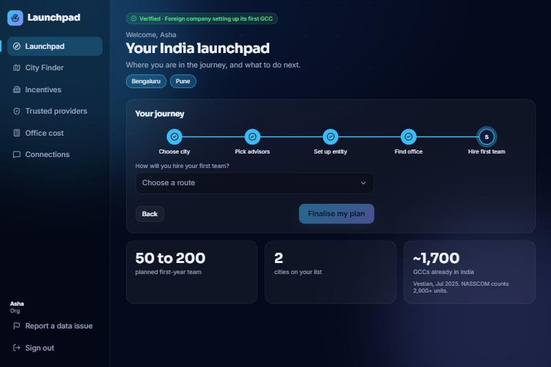
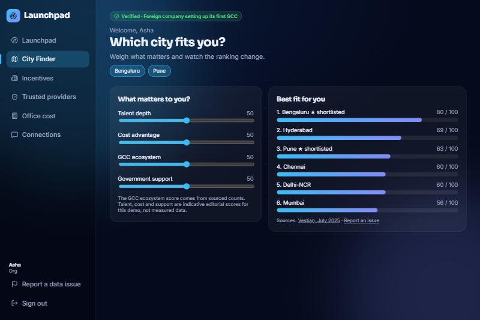
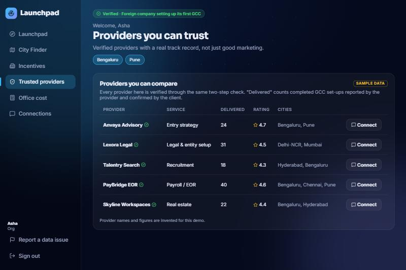
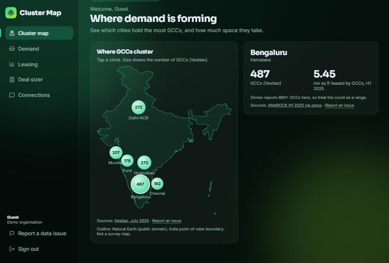
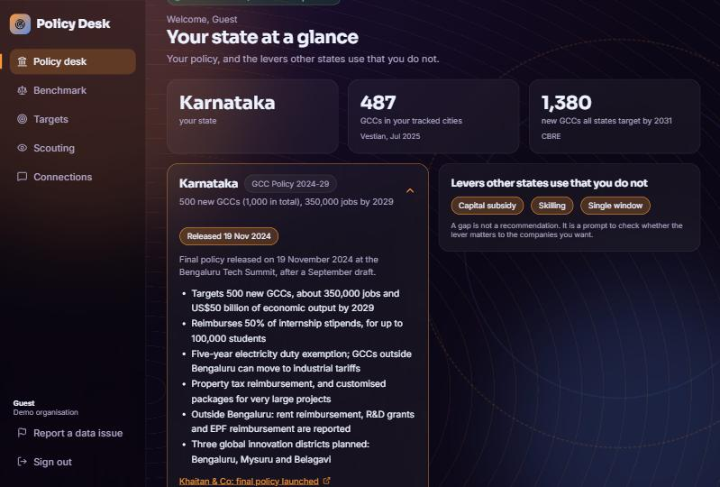

<div align="center">

# GCC Portal

**One source of truth for India's Global Capability Centre ecosystem. Each stakeholder gets a portal built for their job.**

[**Live demo**](https://gcc-portal.himanshu-etc1.workers.dev) · [The problem](#the-problem) · [Stakeholders](#four-stakeholders-four-portals) · [Data](#where-the-data-comes-from) · [Run it](#run-it-locally)


</div>

<p align="center">
  
  
  
</p>

<p align="center">
  
  
  
</p>

> **Try it fast.** Open the live demo, pick a role, and choose **Preview this portal without signing in** to see that stakeholder's dashboard with no sign-up. Or **Continue** to go through the real flow: secure sign-in, two-step verification and onboarding.

## The problem

India has 2,000+ GCCs (offshore centres global companies run for their own tech, finance and operations), and a new company setting one up deals with advisors, lawyers, auditors, real estate firms, recruiters, payroll providers and state governments. Information is scattered across filings, press releases, consultant reports and people's heads. Reports even disagree on the basics: Vestian counts ~1,700 GCCs, NASSCOM counts 2,900+ units. A newcomer ends up relying on referrals.

The portal's bet: a single, sourced, verified view of the ecosystem, **sliced differently for each stakeholder**, because they all want data but not the same data.

## Four stakeholders, four portals

Each role has its own theme, background, onboarding questions, verification and dashboard.

| Role | Comes for | Dashboard |
| --- | --- | --- |
| **Company entering India** (blue) | Where to go, who to trust, what it costs | **Launchpad**: journey tracker, weighted City Finder, state incentives, trusted providers, office-cost estimate |
| **Consultant / Advisor** (amber) | Which GCC is coming next, and who else advises them | **Radar**: lead pipeline, market view with source disagreements, competition, policy watch |
| **Real estate firm** (green) | Where clusters form, who is looking for space | **Cluster Map**: interactive city map, demand, leasing benchmarks, deal sizer |
| **Government** (saffron) | How its incentives compare, who is scouting | **Policy Desk**: state at a glance, incentive-lever benchmark, published targets, scouting |

## Sign-in and verification

- **Sign-in is real.** Email and password through Supabase Auth, with the role stored on the account. Without Supabase keys the app falls back to a local demo mode.
- **Verification is two proofs, tailored to who you are.** First you say what kind of organisation you are. Then you prove the **organisation** and your **authority to act for it**, each with an ID and a document that fits the type. The checks are simulated for the demo: nothing is uploaded or looked up in a real register.

| Role | Kinds you can choose | Proof of the organisation | Proof of your authority |
| --- | --- | --- | --- |
| Company | First GCC, or expanding an existing one | Incorporation ID and certificate (home country, or MCA CIN) | Signatory or employee ID and authorisation letter |
| Consultant | Strategy, law, audit and tax, recruitment / payroll / EOR | GSTIN, firm enrolment or ICAI FRN, with certificate | Partner ID, advocate enrolment or ICAI membership |
| Real estate | Developer, broker, flex operator | RERA project or agent registration, or GSTIN | Signatory or photo ID |
| Government | IT department, investment agency, industries department | Government Order or notification reference | Official service ID and authorisation letter |

After verification, a short onboarding asks what you want to find or deal with, and the dashboard opens on it.

## Where the data comes from

Market facts come from public reports and are linked on screen: Vestian (city GCC counts, July 2025), Zinnov (higher counts for major cities), CBRE and NASSCOM (national totals and state targets), ANAROCK (rent and GCC leasing), and AIM Research (state policies). The portal shows where sources disagree instead of hiding it.

Anything invented for the demo (companies, providers, enquiries, scouting) carries a **Sample data** label. The city-finder's talent, cost and support scores are indicative editorial scores, not measurements, and say so.

## Run it locally

```bash
npm install
cp .env.example .env.local   # add your Supabase URL and publishable key (optional)
npm run dev
```

Without keys the app runs in demo mode with accounts stored in the browser.

## Structure

```
src/
  roles.ts        the four stakeholders: copy, verification and onboarding
  data.ts         sourced market data and clearly marked sample data
  auth.tsx        Supabase auth with a local fallback
  ui.tsx          shared pieces: backgrounds, cards, bars, source notes
  index.css       design tokens and one theme block per role
  pages/          landing, auth, verify, onboarding, dashboard shell
  pages/dash/     one file of views per stakeholder
```

## What is next

- Real verification (MCA, GST and RERA lookups)
- Live data pipelines in place of curated figures
- Provider track records confirmed by clients
- Consent controls so a company decides what advisors and states can see
